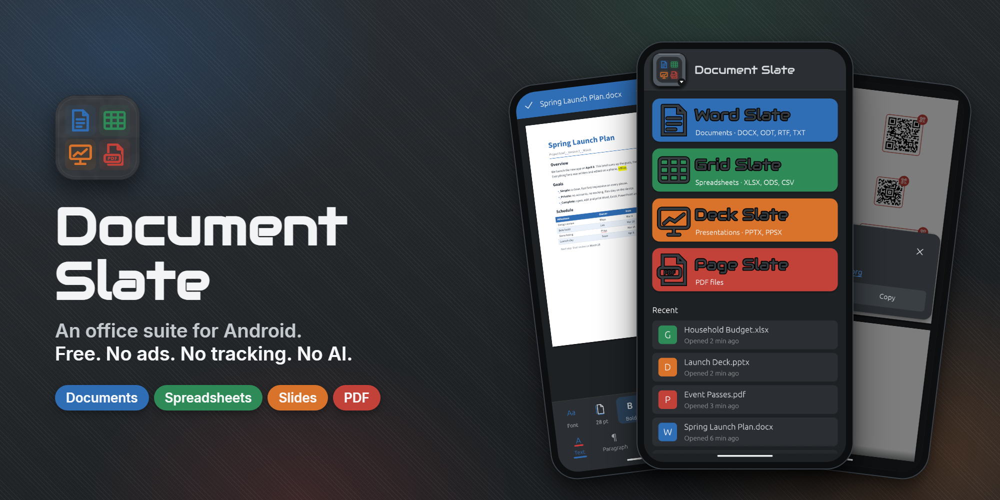
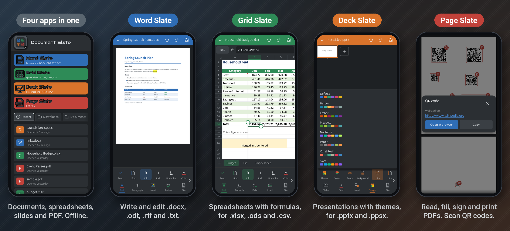

# Document Slate



A privacy-respecting office suite for Android: **free, no ads, no telemetry, no built-in AI.**

One app, four tools:

| Tool      | For                         | Accent  |
|-----------|-----------------------------|---------|
| Word Slate | Documents (.docx .odt .rtf .txt) | Blue |
| Grid Slate | Spreadsheets (.xlsx .xls .ods .csv) | Green |
| Deck Slate | Presentations (.pptx .ppsx) | Orange |
| Page Slate | PDF: comments, forms, fill and sign, certificate signatures | Red |

Files open in a fast viewer; editing loads only when you tap Edit. Printing goes through Android's
own print system to printers on your local network — no cloud.

Also in every tool: links and QR codes / barcodes in documents open with a tap (web addresses go to
your default browser), and Insert › Barcode makes QR, Data Matrix, Aztec, PDF417, Code 128/39,
EAN-13 and UPC-A codes.

Status: **0.1.2**. Download the signed APK from [Releases](https://github.com/HappyRock616/document-slate/releases),
or add this repository to [Obtainium](https://github.com/ImranR98/Obtainium) for automatic updates.
Planned: F-Droid and Play Store.



## Repository layout

```
DocumentSlate/   the Android app (Rust + egui, Gradle project in android/)
Branding/        app icon sources
WordSlate/       upstream engine (submodule: storytold/wordcraft)
GridSlate/       upstream engine (submodule: storytold/gridcraft)
DeckSlate/       upstream engine (submodule: storytold/deckcraft)
PageSlate/       upstream engine (submodule: storytold/printcraft)
craft-i18n/      spelling dictionaries (submodule: storytold/craft-i18n)
```

The document engines come unmodified from the open-source ArtCraft apps and are pinned to tested
commits as git submodules.

## Getting the code

```
git clone --recurse-submodules https://github.com/HappyRock616/document-slate.git
```

Already cloned without submodules? Run `git submodule update --init --depth 1`.

## Building

Full instructions: [BUILDING.md](DocumentSlate/docs/BUILDING.md). Roadmap: [ROADMAP.md](DocumentSlate/docs/ROADMAP.md). Publishing (GitHub, F-Droid): [PUBLISHING.md](DocumentSlate/docs/PUBLISHING.md).

In short, from `DocumentSlate/`:

```
./build-android.ps1      # debug build
./build-release.ps1      # size-optimised arm64 release
```

To install on a phone with `dev/phone-test.sh`, put `PHONE=<serial from adb devices>` in
`DocumentSlate/dev/local.env` (git-ignored).

## Credits and licence

Built on the ArtCraft open-source document engines (MIT OR Apache-2.0). This project is not
affiliated with ArtCraft; the ArtCraft names and logos are not used. Bundled fonts and icons are
credited in [DocumentSlate/ATTRIBUTION.md](DocumentSlate/ATTRIBUTION.md).

Document Slate's own code is licensed under MIT OR Apache-2.0, like the upstream code.
